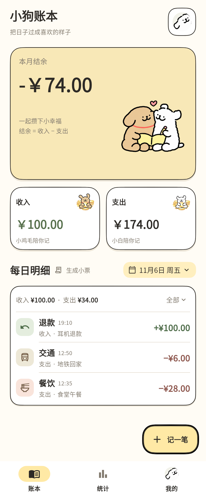
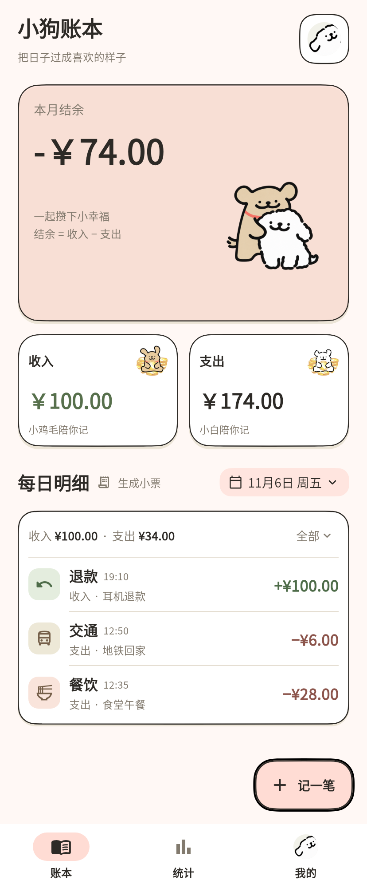
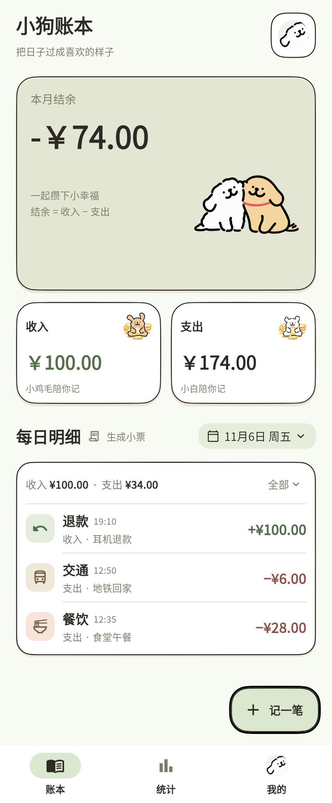
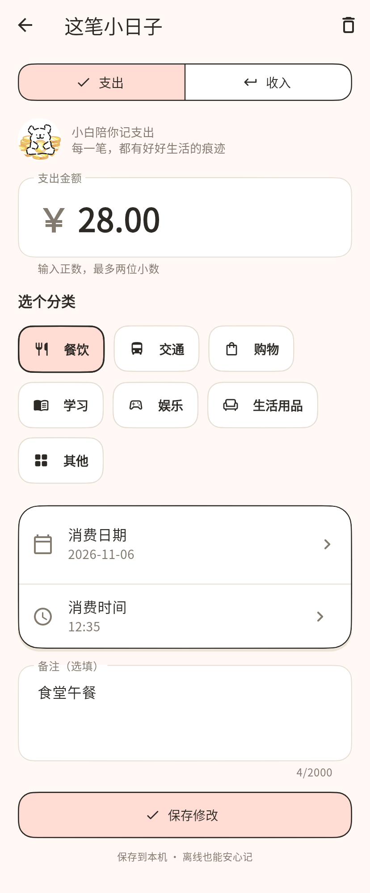
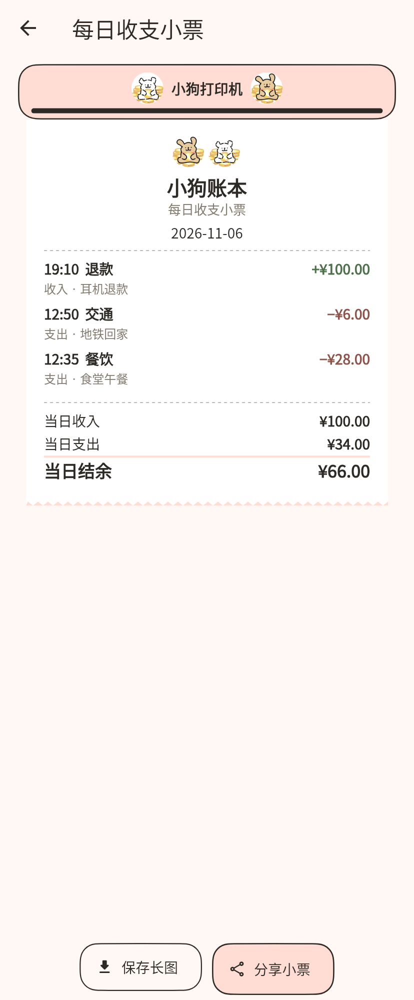
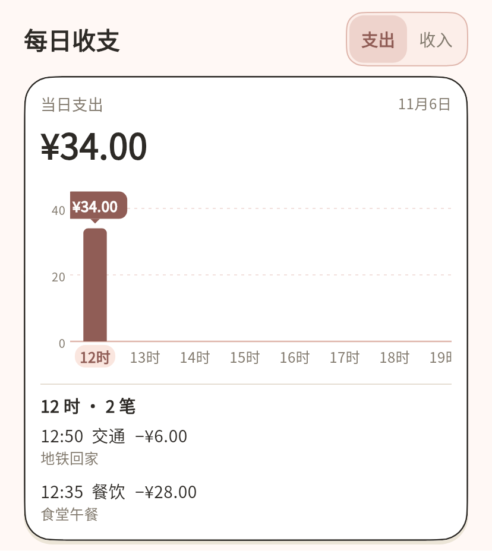
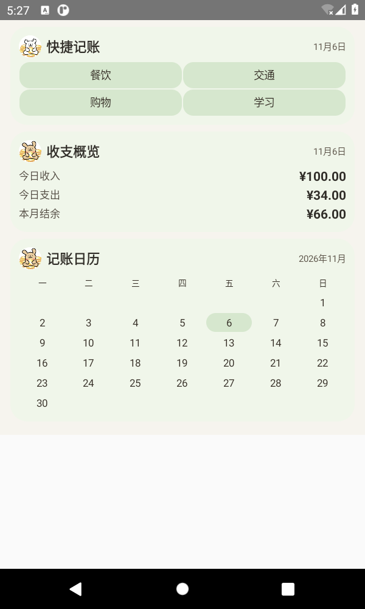

# 小狗账本

一款有小狗陪伴的离线安卓记账应用。记下每天的收入与支出，看看钱花在哪里，再把一天的流水生成一张小票。

账目保存在本机，支持 ZIP 备份与恢复。奶油黄、蜜桃粉、草地绿三套主题，让日常记账多一点温暖。

[下载 Android 安装包](https://github.com/chenchangxiang-330/Puppy-Ledger/releases/tag/v0.1.9) · [使用说明](docs/USAGE.md) · [开发交接](HANDOFF.md)

## 界面预览

### 三套主题

| 奶油黄 | 蜜桃粉 | 草地绿 |
| :---: | :---: | :---: |
|  |  |  |

### 记账与每日小票

填写金额、分类和发生时间，保存每一笔日常。当天的完整流水可以生成小票，保存为长图或通过系统分享。

| 记一笔 | 每日收支小票 |
| :---: | :---: |
|  |  |

### 收支统计与安卓桌面组件

按日、周、月查看收支；日统计可以点选小时查看流水。桌面组件提供快捷记账、收支概览和记账日历。

| 按小时查看每日收支 | 三种安卓桌面组件 |
| :---: | :---: |
|  |  |

截图使用演示账目；桌面组件图来自 Android 11 模拟器中的组件宿主。

## 主要功能

- **日常收支**：记录收入与支出，支持分类、备注、发生日期和时间，以及账目编辑和删除撤销。
- **账目回顾**：按日期浏览流水，筛选收入或支出，查看每日收支和本月结余。
- **收支统计**：按日、周、月汇总；日统计可展开每个小时的逐笔记录。
- **每日小票**：将当天完整流水生成主题小票，保存 PNG 长图或分享。
- **桌面组件**：快捷记账、收支概览、记账日历，方便从桌面进入应用。
- **个性化与备份**：切换三套主题、调整小狗分工、管理分类，导出或恢复完整 ZIP 备份。

## 下载与安装

当前版本为 **0.1.9+10**，支持 **Android 7.0 及以上**，安装包包含 `arm64-v8a` 和 `x86_64` 架构。

前往 [v0.1.9 版本页面](https://github.com/chenchangxiang-330/Puppy-Ledger/releases/tag/v0.1.9)，下载 `puppy-ledger-0.1.9-release.apk` 安装。页面同时保留原始源码包、完整截图包和交接文档。

升级已有安装需要保持签名一致。更换签名前，请先导出账本备份；具体步骤见 [升级说明](HANDOFF.md#5-下一版如何覆盖安装)。

## 继续开发

项目使用 **Flutter、Dart 与 SQLite**，源码位于仓库根目录。完整环境配置、源码入口、数据约定与签名说明见 [HANDOFF.md](HANDOFF.md)。

```sh
flutter pub get --enforce-lockfile
flutter analyze
flutter test
flutter run --flavor linepuppy
```

构建 Android Release APK：

```sh
flutter build apk --release --flavor linepuppy --target-platform android-arm64,android-x64
```

- [使用与数据兼容](docs/USAGE.md)
- [构建环境](docs/TOOLCHAIN.md)
- [验证记录](docs/VALIDATION.md)
- [素材说明](docs/ASSETS.md)

素材来源与使用记录见素材说明，角色素材为非官方演绎。
